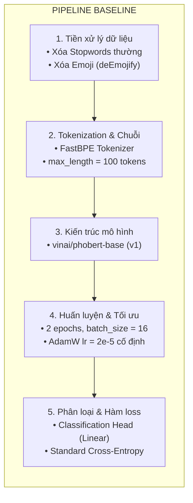

# ĐẶC TẢ CHI TIẾT NỘI DUNG SLIDE BÁO CÁO NGHIÊN CỨU

## Đề tài: Nghiên cứu và Cải tiến Mô hình Phát hiện Phát ngôn Thù ghét trên Mạng xã hội Tiếng Việt (ViHSD) dựa trên Kiến trúc PhoBERT

# SLIDE 1: Giới thiệu đề tài và thành viên

### 1. Mục tiêu của slide

- Mở đầu bài báo cáo, giới thiệu tên đề tài, phạm vi nghiên cứu và nhóm thực hiện.
- Định vị bài toán trong lĩnh vực Xử lý Ngôn ngữ Tự nhiên (NLP) tiếng Việt và nêu bật ý nghĩa thực tiễn của đề tài trong việc kiểm duyệt nội dung mạng xã hội.

### 2. Bố cục và nội dung chính trên slide

- **Tên đề tài:** Nghiên cứu và Nâng cao Hiệu năng Mô hình Phát hiện Phát ngôn Thù ghét trên Mạng xã hội Tiếng Việt (Vietnamese Hate Speech Detection - ViHSD)
- **Mô hình nền tảng:** PhoBERT (Pre-trained Language Model for Vietnamese)
- **Đơn vị / Nhóm thực hiện:** Nhóm 2
- **Danh sách thành viên:**
  - Thành viên 1: Nguyễn Thành Trí - 6451071079
  - Thành viên 2: Đặng Ngọc Hiếu - 6451071024
  - Thành viên 3: Lương Thị Kim Ngân - 6451071049
  - Thành viên 4: Lê Công Tài - 641071067
- **Giảng viên hướng dẫn:** [Ths. Trần Thị Dung]

### 3. Hình ảnh / Sơ đồ đề xuất chèn vào slide

- Logo trường đại học giao thông vận tải UTC2
- Sơ đồ minh họa trực quan bài toán: Bình luận mạng xã hội tiếng Việt $\to$ Mô hình NLP $\to$ Phân loại 3 lớp (CLEAN / OFFENSIVE / HATE).

### 4. Lời thoại thuyết trình gợi ý (Speaker Notes)

"Kính thưa quý thầy cô và các bạn, hôm nay Nhóm 2 xin phép được trình bày đề tài nghiên cứu: 'Cải tiến mô hình phát hiện phát ngôn thù ghét trên mạng xã hội tiếng Việt dựa trên kiến trúc PhoBERT'. Sự bùng nổ của mạng xã hội kéo theo làn sóng gia tăng các phát ngôn độc hại, công kích cá nhân và phân biệt đối xử. Do đó, bài toán lọc và phát hiện phát ngôn thù ghét tự động có ý nghĩa cấp thiết. Trong báo cáo này, nhóm sẽ trình bày chi tiết hành trình phân tích các điểm nghẽn của mô hình baseline công bố năm 2021, từ đó đề xuất hệ thống 7 mốc thực nghiệm cải tiến có tính kế thừa khoa học chặt chẽ, giải quyết triệt để vấn đề mất cân bằng dữ liệu và đặc thù ngôn ngữ mạng xã hội tiếng Việt."

---

# SLIDE 2: Tổng quan kết quả thực nghiệm nổi bật (Executive Summary)

### 1. Mục tiêu của slide

- Cung cấp ngay cho Hội đồng / Giảng viên bức tranh tổng quan về kết quả thực nghiệm tốt nhất đạt được của đề tài trước khi đi sâu vào chi tiết kỹ thuật.
- Khẳng định mức độ cải tiến vượt trội của mô hình đề xuất so với Baseline gốc (Lưu et al., 2021) trên tập kiểm thử chuẩn ViHSD.

### 2. Bố cục và nội dung chính trên slide

#### A. Các chỉ số hiệu năng then chốt (Key Highlights)
- **Macro-F1 (Thước đo chính):** Đạt **0.6626 (66.26%)** $\to$ **Tăng +4.30%** tuyệt đối so với Baseline gốc (0.6196).
- **F1 Lớp OFFENSIVE (Xúc phạm):** Đạt **0.4544** $\to$ **Tăng vọt +8.79%** so với Baseline gốc (0.3665).
- **F1 Lớp HATE (Thù ghét):** Đạt **0.5952** $\to$ **Tăng +3.83%** so với Baseline gốc (0.5569).
- **Accuracy tổng thể:** Đạt **0.8737 (87.37%)** $\to$ Tăng nhẹ +0.65% trong khi giải quyết triệt để vấn đề thiên lệch lớp đa số.

#### B. Bảng đối chiếu toàn diện: Pipeline & Kết quả (Baseline vs Mô hình Đề xuất Tối ưu CP05)

| Thành phần Pipeline / Chỉ số | Baseline Gốc (Lưu et al., 2021) | Mô hình Đề xuất Tối ưu (CP05) | Điểm cải tiến & Mức tăng trưởng ($\Delta$) |
| :--- | :--- | :--- | :--- |
| **1. Tiền xử lý dữ liệu** | Xóa stopwords cơ bản, deEmojify (xóa sạch emoji), giữ nguyên teencode/từ lặp | **`ViHSDPreprocessor`:** Giữ nguyên đại từ nhân xưng & từ phủ định; bộ Teencode chọn lọc 412 từ; ánh xạ Emoji 2 pha; tách từ PyVi | Khắc phục OOV, giữ trọn sắc thái châm biếm và đối tượng bị công kích |
| **2. Độ dài chuỗi & Tokenizer** | FastBPE, `max_length = 100` | FastBPE, **`max_length = 256`** | Giữ trọn ngữ cảnh bình luận dài, không bị cắt cụt câu chốt hạ ở đuôi |
| **3. Hàm mất mát (Loss)** | Standard Cross-Entropy (không trọng số) | **Weighted Focal Loss** ($\alpha = [0.47, 1.67, 1.32]$, $\gamma = 1.5$) | Cân bằng phạt tĩnh chống lệch lớp + giảm nhiễu mẫu dễ động |
| **4. Chiến lược huấn luyện** | 2 epochs, LR cố định $2 \times 10^{-5}$ toàn mạng, Linear Decay | **8 epochs + Early Stopping**, Differential LR ($2\times 10^{-5}$ / $1\times 10^{-4}$), Cosine Warmup | Hội tụ sâu, tối ưu nhanh Classification Head mà không phá vỡ Backbone |
| **Macro-F1 (Thước đo chính)** | **0.6196 (61.96%)** | **0.6626 (66.26%)** | **+4.30%** 🚀 *(Đạt đỉnh hiệu năng thực nghiệm)* |
| **F1 - Lớp OFFENSIVE (1)** | 0.3665 (36.65%) | **0.4544 (45.44%)** | **+8.79%** 🔥 *(Bứt phá nhận diện lớp hiếm)* |
| **F1 - Lớp HATE (2)** | 0.5569 (55.69%) | **0.5952 (59.52%)** | **+3.83%** 🔥 *(Nhận diện thù ghét chính xác hơn)* |
| **F1 - Lớp CLEAN (0)** | 0.9354 (93.54%) | **0.9382 (93.82%)** | **+0.28%** *(Giữ vững độ chính xác lớp đa số)* |
| **Accuracy (Độ chính xác)** | 0.8672 (86.72%) | **0.8737 (87.37%)** | **+0.65%** |
| **Macro-Recall (Độ nhạy)** | 0.5933 (59.33%) | **0.6493 (64.93%)** | **+5.60%** *(Vớt lại phần lớn mẫu độc hại bị bỏ sót)* |

#### C. Công thức tạo nên thành công của mô hình đề xuất (CP05)
1. **Tiền xử lý thông minh (`ViHSDPreprocessor`):** Bảo tồn tuyệt đối đại từ nhân xưng & từ phủ định; tích hợp bộ Teencode chọn lọc 412 từ và ánh xạ Emoji 2 pha.
2. **Chiến lược huấn luyện sâu:** Mở rộng `max_length = 256`, phân tầng Differential LR ($2\times 10^{-5}$ backbone / $1\times 10^{-4}$ head), Cosine Warmup & Early Stopping.
3. **Hàm mất mát tích hợp Weighted Focal Loss:** Kết hợp phạt tĩnh Smoothed Class Weights $\alpha = [0.47, 1.67, 1.32]$ và phạt động theo độ khó mẫu $\gamma = 1.5$.

### 3. Hình ảnh / Sơ đồ đề xuất chèn vào slide

- Biểu đồ cột nhóm so sánh trực quan F1 của từng lớp: Baseline Gốc vs Mô hình Đề xuất Tối ưu (CP05).
- 3 thẻ chỉ số (KPI Cards) nổi bật: Macro-F1 (66.26% / +4.30%), F1-OFFENSIVE (+8.79%), F1-HATE (+3.83%).

### 4. Lời thoại thuyết trình gợi ý (Speaker Notes)

"Trước khi đi sâu vào chi tiết các mốc kỹ thuật, nhóm xin phép được chia sẻ ngay kết quả nổi bật nhất mà đề tài đã đạt được. Trên cùng tập kiểm thử ViHSD chuẩn với 6.680 bình luận, mô hình tích hợp toàn diện của nhóm tại Checkpoint 05 đã đạt chỉ số Macro-F1 là 66.26%, tăng trưởng vượt bậc 4.3% so với baseline công bố năm 2021. Đáng chú ý nhất, độ nhạy và F1-score trên hai lớp khó là OFFENSIVE và HATE đều bứt phá mạnh mẽ, lần lượt tăng tới 8.79% và 3.83%. Trong các slide tiếp theo, nhóm sẽ lần lượt bóc tách từng nút thắt kỹ thuật và hành trình hiện thực hóa mức tăng trưởng ấn tượng này."

---

# SLIDE 3: Phân tích bộ dữ liệu (ViHSD Dataset Analysis)

### 1. Mục tiêu của slide

- Cung cấp bức tranh toàn cảnh về tập dữ liệu chuẩn ViHSD (Lưu et al., 2021).
- Làm rõ định nghĩa 3 lớp gán nhãn và phân tích định lượng hiện tượng mất cân bằng nhãn nghiêm trọng.
- Nêu bật các thách thức ngôn ngữ học đặc thù của văn bản mạng xã hội tiếng Việt.

### 2. Bố cục và nội dung chính trên slide

- **Tổng quan tập dữ liệu ViHSD:**
  - Quy mô: 33.400 bình luận thu thập thực tế từ nền tảng Facebook và YouTube.
  - Phân chia tập dữ liệu: Tập huấn luyện (Train: 24.048 mẫu ~ 72%), tập phát triển (Dev: 2.672 mẫu ~ 8%), tập kiểm thử (Test: 6.680 mẫu ~ 20%).
- **Định nghĩa 3 lớp nhãn và phân bố mẫu:**
  - **Nhãn 0 - CLEAN (Sạch - 82.7%):** Bình luận mang tính xây dựng, trung tính hoặc tích cực; không chứa từ ngữ thô tục hay công kích.
  - **Nhãn 1 - OFFENSIVE (Xúc phạm - 6.7%):** Bình luận chứa từ ngữ thô tục, chửi thề nhưng mang tính giải tỏa cảm xúc cá nhân, không nhắm vào đối tượng cụ thể.
  - **Nhãn 2 - HATE (Thù ghét - 10.6%):** Phát ngôn thù địch nhắm trực diện xúc phạm danh dự, nhân phẩm của cá nhân, tổ chức, chủng tộc, tôn giáo, vùng miền hoặc giới tính.
- **Thách thức cốt lõi (Core Challenges):**
  1. _Mất cân bằng dữ liệu cực đoan:_ Lớp CLEAN chiếm tới ~83%, trong khi hai lớp độc hại chỉ chiếm ~17% tổng thể.
  2. _Nhiễu ngôn ngữ mạng xã hội (Social Media Noise):_ Viết tắt, teencode, cố tình sai chính tả né kiểm duyệt, lặp ký tự kéo dài cảm xúc (`ngonnnn`), sử dụng emoji mang tính mỉa mai và ngữ cảnh phức tạp.
- **Hệ quả học máy:** Độ chính xác tổng thể (Accuracy) không phản ánh đúng năng lực nhận diện của mô hình. Thước đo đánh giá bắt buộc phải là **Macro-F1**.

### 3. Bảng số liệu phân bố tập dữ liệu

| Tập dữ liệu         |   Nhãn 0 (CLEAN)    | Nhãn 1 (OFFENSIVE) |   Nhãn 2 (HATE)    | Tổng số mẫu | Tỷ lệ (%) |
| :------------------ | :-----------------: | :----------------: | :----------------: | :---------: | :-------: |
| **Train set**       |   19.896 (~82.7%)   |   1.611 (~6.7%)    |   2.541 (~10.6%)   |   24.048    |    72%    |
| **Dev set**         |   2.208 (~82.6%)    |    182 (~6.8%)     |    282 (~10.6%)    |    2.672    |    8%     |
| **Test set**        |   5.524 (~82.7%)    |    451 (~6.8%)     |    705 (~10.6%)    |    6.680    |    20%    |
| **Toàn bộ dataset** | **27.628 (~82.7%)** | **2.244 (~6.7%)**  | **3.528 (~10.6%)** | **33.400**  | **100%**  |

### 4. Hình ảnh / Sơ đồ đề xuất chèn vào slide

- Biểu đồ tròn (Pie Chart) hoặc biểu đồ cột xếp chồng biểu diễn độ lệch phân bố giữa 3 lớp.
- Bảng ví dụ thực tế về 3 câu bình luận mẫu thuộc 3 nhãn để người nghe dễ hình dung ranh giới ngữ nghĩa.

### 5. Lời thoại thuyết trình gợi ý (Speaker Notes)

"Tập dữ liệu ViHSD được công bố bởi nhóm tác giả Lưu và cộng sự năm 2021, gồm 33.400 bình luận mạng xã hội. Thách thức lớn nhất khi tiếp cận bộ dữ liệu này nằm ở hai yếu tố: Thứ nhất là tỷ lệ mất cân bằng nghiêm trọng. Lớp CLEAN chiếm tới gần 83%, trong khi lớp OFFENSIVE chỉ vỏn vẹn 6.7% và HATE chỉ có 10.6%. Nếu một mô hình đơn giản chỉ cần đoán tất cả mẫu là CLEAN thì đã dễ dàng đạt Accuracy 83%, nhưng hoàn toàn vô dụng trong việc ngăn chặn nội dung độc hại. Do đó, thước đo chính của chúng ta phải là Macro-F1. Thách thức thứ hai là đặc thù viết tắt, dùng tiếng lóng và cố tình gõ sai ký tự để lách kiểm duyệt của người dùng mạng xã hội Việt Nam."

---

# SLIDE 4: Phân tích pipeline baseline, đưa ra các yếu điểm và hướng có thể cải tiến

### 1. Mục tiêu của slide

- Trực quan hóa cấu trúc Pipeline Baseline (Lưu et al., 2021) chia thành các phân đoạn chức năng rõ ràng.
- Từ từng phân đoạn của pipeline, bóc tách chính xác các điểm nghẽn kỹ thuật (bottlenecks) dẫn đến hiệu năng hạn chế của Baseline (Macro-F1 chỉ 0.6196).
- Đặt tiền đề khoa học cho hệ thống các mốc cải tiến (Checkpoints) giải quyết triệt để từng điểm nghẽn.

### 2. Bố cục và nội dung chính trên slide

#### A. Bố cục trực quan đề xuất (Layout 2 cột: Pipeline bên trái | Checklist cải tiến bên phải)

**1. Cột bên trái: Pipeline Baseline chuẩn (Lưu et al., 2021)**

**2. Cột bên phải: Checklist các điểm nghẽn & Định hướng cải tiến**

*(Độc lập dạng danh sách kiểm tra / bullet points, tương ứng với từng giai đoạn bên trái nhưng không vẽ đường dây nối rối mắt)*

- [ ] **1. Tiền xử lý dữ liệu (Data Preprocessing):**
  - ⚠️ *Điểm nghẽn:* Xóa nhầm đại từ nhân xưng (`mày`, `tao`, `thằng`, `con`) và từ phủ định (`không`, `chẳng`); mất sắc thái châm biếm của emoji; lỗi OOV do teencode.
  - 💡 *Hướng cải tiến:* Xây dựng `ViHSDPreprocessor` bảo tồn đại từ/phủ định, từ điển Teencode 412 từ, cơ chế Emoji 2 pha, tách từ PyVi *(Checkpoint 03)*.

- [ ] **2. Độ dài chuỗi (Sequence Length):**
  - ⚠️ *Điểm nghẽn:* Giới hạn 100 tokens cắt cụt các bình luận dài (nơi câu chốt công kích thường nằm ở cuối đoạn).
  - 💡 *Hướng cải tiến:* Nâng `max_length = 256` tokens khai thác tối đa positional embeddings của PhoBERT *(Checkpoint 04)*.

- [ ] **3. Kiến trúc nền tảng (Backbone):**
  - ⚠️ *Điểm nghẽn:* Phiên bản v1 học từ 4GB báo chí, vốn từ hạn chế trước từ lóng/teencode mạng xã hội hiện đại.
  - 💡 *Hướng cải tiến:* Khảo sát nâng cấp `phobert-base-v2` huấn luyện trên 20GB ngữ liệu web phong phú *(Checkpoint 06)*.

- [ ] **4. Chiến lược huấn luyện (Training Strategy):**
  - ⚠️ *Điểm nghẽn:* 2 epochs chưa kịp hội tụ; dùng chung 1 LR khiến classification head học chậm hoặc làm lệch trọng số backbone; thiếu Early Stopping chống overfitting.
  - 💡 *Hướng cải tiến:* Differential LR ($2\times 10^{-5}$ backbone vs $1\times 10^{-4}$ head), Cosine Annealing with Warmup, tăng lên 8 epochs + Early Stopping theo dõi Macro-F1 *(Checkpoint 04)*.

- [ ] **5. Xử lý mất cân bằng lớp (Class Imbalance & Loss):**
  - ⚠️ *Điểm nghẽn:* Hàm Standard Cross-Entropy bị 82.7% mẫu CLEAN đè bẹp gradient, mô hình bỏ lọt phần lớn mẫu HATE và OFFENSIVE.
  - 💡 *Hướng cải tiến:* Cân bằng tĩnh Smoothed Class Weights *(CP01)* $\to$ Cân bằng động Focal Loss *(CP02)* $\to$ Tích hợp Weighted Focal Loss *(CP05)*.

#### B. Bảng đối chiếu 4 phân đoạn Pipeline: Hiện trạng $\to$ Điểm nghẽn $\to$ Giải pháp

| Phân đoạn Pipeline | Thiết lập ở Baseline gốc | Điểm nghẽn kỹ thuật cốt lõi | Hướng cải tiến & Mốc thực nghiệm |
| :--- | :--- | :--- | :--- |
| **1. Tiền xử lý dữ liệu** *(Data Preprocessing)* | • Xóa từ dừng (`vietnamese-stopwords.txt`) • Xóa triệt để emoji (`deEmojify`) • Giữ nguyên teencode và từ lặp | • Mất sạch đại từ (`mày`, `tao`, `nó`, `thằng`, `con`) chỉ thị đối tượng bị công kích. • Mất từ phủ định (`không`, `chẳng`) đổi chiều ngữ nghĩa. • Mất sắc thái mỉa mai của emoji; vỡ từ OOV do teencode. | **Checkpoint 03 (`ViHSDPreprocessor`):** Bảo tồn đại từ & từ phủ định, chuẩn hóa Teencode 412 từ, cơ chế Emoji 2 pha, tách từ `PyVi`. |
| **2. Biểu diễn chuỗi** *(Sequence Representation)* | • Mã hóa FastBPE • Cắt chuỗi tại `max_length = 100` tokens | • Cắt cụt các bình luận dài, tranh luận đa chiều vốn thường đặt phát ngôn thù ghét ở cuối văn bản. | **Checkpoint 04:** Nâng `max_length = 256` tokens (khai thác trọn vẹn không gian nhúng vị trí của PhoBERT). |
| **3. Chiến lược huấn luyện** *(Training Strategy)* | • Huấn luyện 2 epochs cố định • LR cố định $2 \times 10^{-5}$ cho toàn bộ mạng • Bộ lập lịch Linear Decay | • 2 epochs là quá ngắn, mô hình chưa đạt điểm hội tụ tối ưu. • Classification Head ngẫu nhiên cần học nhanh nhưng bị kìm chân bởi LR nhỏ; backbone dễ bị rung lắc trọng số. • Không có cơ chế dừng sớm chống overfitting. | **Checkpoint 04:** Phân tầng tốc độ học Differential LR ($2\times 10^{-5}$ backbone vs $1\times 10^{-4}$ head), Cosine Warmup, 8 epochs + Early Stopping theo dõi Macro-F1. |
| **4. Hàm mất mát & Cân bằng lớp** *(Loss & Class Imbalance)* | • Hàm Standard Cross-Entropy • Trọng số phạt đồng nhất $[1.0, 1.0, 1.0]$ | • Tín hiệu gradient từ 82.7% mẫu CLEAN đè bẹp hoàn toàn 2 lớp thiểu số, khiến mô hình thiên lệch nặng về đoán nhãn CLEAN. | **Checkpoint 01, 02 & 05:** • CP01: Cân bằng tĩnh Smoothed Class Weights. • CP02: Cân bằng động mẫu khó Focal Loss ($\gamma = 1.5$). • CP05: Tích hợp Weighted Focal Loss. |

### 3. Hình ảnh / Sơ đồ đề xuất chèn vào slide

- **Bố cục slide 2 cột trực quan (Side-by-side):**
  - **Nửa bên trái:** Sơ đồ khối pipeline đơn giản dạng dọc hoặc ngang tuần tự từ bước 1 đến bước 5 (không có đường nối chéo nào sang bên phải).
  - **Nửa bên phải:** Card/Khung chứa danh sách checklist 5 điểm nghẽn tương ứng kèm icon ⚠️ và hướng cải tiến đề xuất 💡 (Checkpoint tương ứng), giúp người xem dễ đối chiếu mà slide vẫn rất thoáng và sạch sẽ.

### 4. Lời thoại thuyết trình gợi ý (Speaker Notes)

"Kính thưa thầy cô, để có cơ sở khoa học vững chắc cho các cải tiến, nhóm đã mổ xẻ toàn bộ quy trình xử lý của mô hình Baseline thành 4 phân đoạn chức năng chính:
- **Phân đoạn 1 là Tiền xử lý dữ liệu:** Điểm nghẽn chí mạng của Baseline là xóa stopword một cách máy móc, làm mất đi các đại từ nhân xưng như 'mày', 'tao', 'thằng' và các từ phủ định - vốn là tín hiệu quyết định để nhận diện phát ngôn thù ghét. Để khắc phục, nhóm đề xuất module `ViHSDPreprocessor` tại Checkpoint 03.
- **Phân đoạn 2 là Biểu diễn chuỗi:** Baseline cắt ở 100 tokens làm mất ngữ cảnh của các bình luận dài. Nhóm mở rộng lên 256 tokens ở Checkpoint 04 để giữ trọn vẹn ngữ cảnh.
- **Phân đoạn 3 là Chiến lược huấn luyện:** 2 epochs là quá ít để mô hình học sâu, đồng thời việc dùng chung một tốc độ học cho cả Backbone lẫn Head phân loại là chưa tối ưu. Nhóm đưa vào cơ chế phân tầng learning rate, Cosine Warmup và Early Stopping tại Checkpoint 04.
- **Và phân đoạn 4 là Hàm mất mát:** Cross-Entropy tiêu chuẩn bị 83% mẫu CLEAN chi phối hoàn toàn. Nhóm lần lượt giải quyết bằng Cân bằng tĩnh Class Weights ở Checkpoint 01, Cân bằng động Focal Loss ở Checkpoint 02, và tích hợp đỉnh cao Weighted Focal Loss ở Checkpoint 05.
Đây chính là kim chỉ nam xuyên suốt toàn bộ các thực nghiệm tiếp theo của nhóm."

---

# SLIDE 5: Cải tiến bằng phương pháp cân bằng CW (Class Weights - Checkpoint 01)

### 1. Mục tiêu của slide

- Trình bày cơ sở toán học và cơ chế hoạt động của phương pháp Cân bằng Lớp Tĩnh (Class Weights).
- So sánh giữa công thức Nghịch đảo Tần suất thuần túy (ICF) và phương pháp Làm mịn Căn bậc hai (Smoothed Class Weights).
- Giải thích vì sao phương pháp làm mịn lại tối ưu hơn cho bài toán ViHSD.

### 2. Bố cục và nội dung chính trên slide

- **Nguyên lý phương pháp:**
  - Can thiệp trực tiếp vào hàm mất mát Cross-Entropy bằng cách gán cho mỗi lớp một trọng số phạt $\alpha_c$ cố định dựa trên tần suất xuất hiện của lớp đó trong tập huấn luyện:
    $$\mathcal{L}_{\text{Weighted CE}} = - \sum_{i} \alpha_{y_i} \log(p_{i, y_i})$$
  - Khi mô hình dự đoán sai một mẫu thuộc lớp thiểu số (OFFENSIVE hoặc HATE), hàm mất mát sẽ phạt nặng hơn so với việc đoán sai một mẫu CLEAN.
- **So sánh hai công thức tính trọng số:**
  1. _Nghịch đảo tần suất chuẩn (Inverse Class Frequency - ICF):_
     $$w_c = \frac{N}{K \cdot N_c} \implies \text{Tỷ lệ phạt: } \frac{w_{\text{OFFENSIVE}}}{w_{\text{CLEAN}}} \approx 12.39 \text{ lần}$$
     - _Hạn chế:_ Mức phạt 12.39 lần là quá gắt, khiến mô hình rơi vào trạng thái 'hoảng loạn', có xu hướng đoán mò vào lớp thiểu số để tránh bị phạt nặng, dẫn đến vỡ độ chuẩn xác (Precision) của lớp CLEAN.
  2. _Làm mịn căn bậc hai (Smoothed Inverse Class Frequency - Đề xuất tại CP01):_
     $$w_c = \sqrt{\frac{N}{N_c}} \bigg/ \left( \frac{1}{K} \sum_{j=0}^{K-1} \sqrt{\frac{N}{N_j}} \right) \implies \text{Tỷ lệ phạt: } \frac{w_{\text{OFFENSIVE}}}{w_{\text{CLEAN}}} \approx 3.52 \text{ lần}$$
     - _Ưu thế:_ Kiểm soát chênh lệch phạt ở mức lý tưởng (~3.52 lần), đủ lực thúc đẩy nhận diện lớp hiếm nhưng không phá vỡ ranh giới quyết định của lớp đa số.
- **Thiết lập thực nghiệm:** Giữ nguyên 100% cấu hình Baseline gốc (2 epochs, lr = $2 \times 10^{-5}$, max_length = 100, không tiền xử lý) để cô lập độc lập tác động của Smoothed CW.

### 3. Bảng vector trọng số lớp tính toán trên tập ViHSD Train

| Phương pháp tính trọng số       | $\alpha_0$ (CLEAN) | $\alpha_1$ (OFFENSIVE) | $\alpha_2$ (HATE) | Tỷ lệ lệch phạt cực đại |
| :------------------------------ | :----------------: | :--------------------: | :---------------: | :---------------------: |
| **Không trọng số (Baseline)**   |       1.0000       |         1.0000         |      1.0000       |          1.00x          |
| **Nghịch đảo tuyến tính (ICF)** |       0.4029       |         4.9758         |      3.1547       |         ~12.35x         |
| **Làm mịn căn bậc hai (CP01)**  |     **0.4735**     |       **1.6657**       |    **1.3242**     |       **~3.52x**        |

### 4. Hình ảnh / Sơ đồ đề xuất chèn vào slide

- Đồ thị so sánh độ dốc phạt giữa 3 phương pháp tính trọng số.

### 5. Lời thoại thuyết trình gợi ý (Speaker Notes)

"Giải pháp đầu tiên nhóm triển khai tại Checkpoint 01 là cân bằng trọng số lớp tĩnh (Class Weights). Nếu sử dụng công thức nghịch đảo tần suất thông thường, trọng số của lớp OFFENSIVE sẽ cao gấp hơn 12 lần lớp CLEAN. Mức phạt quá nặng này sẽ phản tác dụng, khiến mô hình đoán bừa mọi bình luận nghi ngờ thành OFFENSIVE, làm sụp đổ Precision của lớp CLEAN. Nhóm đã áp dụng công thức làm mịn căn bậc hai, kéo tỷ lệ chênh lệch xuống mức vừa phải là 3.52 lần. Điều này vừa giúp mô hình chú ý đến các phát ngôn độc hại, vừa giữ được sự ổn định cho lớp đa số."

---

# SLIDE 6: So sánh kết quả CW với baseline, giải thích

### 1. Mục tiêu của slide

- Trình bày bảng đối sánh định lượng giữa Baseline gốc và Checkpoint 01 (Smoothed Class Weights).
- Phân tích sự đánh đổi kỹ thuật (Trade-off) giữa Precision và Recall.
- Giải thích nguyên nhân dẫn đến sự cải thiện của chỉ số Macro-F1.

### 2. Bố cục và nội dung chính trên slide

- **Bảng đối sánh kết quả thực nghiệm:**
  _(Lưu ý: Bảng hiển thị khung đối chuẩn, số liệu cụ thể điền theo kết quả chạy mới nhất)_
  | Chỉ số đánh giá | Baseline Gốc (2021) | Checkpoint 01 (Smoothed CW) | Độ chênh lệch ($\Delta$) |
  | :--- | :---: | :---: | :---: |
  | **Macro-F1 (Chính)** | 0.6196 | **0.6512** | **+3.16%** |
  | **Accuracy** | 0.8672 | 0.8603 | -0.69% |
  | **F1 - Lớp CLEAN (0)** | 0.9354 | 0.9314 | -0.40% |
  | **F1 - Lớp OFFENSIVE (1)**| 0.3665 | 0.4180 | **+5.15%** |
  | **F1 - Lớp HATE (2)** | 0.5569 | 0.6042 | **+4.73%** |
  | **Macro-Precision** | 0.6561 | 0.6457 | -1.04% |
  | **Macro-Recall** | 0.5933 | 0.6607 | **+6.74%** |

- **Phân tích cơ chế và giải thích kết quả:**
  1. _Sự bứt phá của độ nhạy (Recall) trên lớp thiểu số:_ Lực phạt tĩnh $\alpha_1 = 1.67$ và $\alpha_2 = 1.32$ buộc mô hình dịch chuyển ngưỡng phân định sang phía lớp thiểu số, giúp vớt lại hàng loạt mẫu thù ghét mà Baseline từng bỏ sót.
  2. _Sự đánh đổi Precision - Recall được kiểm soát tốt:_ Do áp dụng làm mịn căn bậc hai thay vì ICF gắt gao, F1 của lớp CLEAN không bị suy giảm đáng kể, giúp tổng thể Macro-F1 tăng trưởng dương.
  3. _Quan sát trên Ma trận nhầm lẫn (Confusion Matrix):_ Số lượng mẫu HATE và OFFENSIVE bị gán nhãn nhầm thành CLEAN giảm rõ rệt so với Baseline.

### 3. Hình ảnh / Sơ đồ đề xuất chèn vào slide

- Đặt cạnh nhau 2 ảnh Confusion Matrix: Baseline vs Checkpoint 01 (Heatmap trực quan).

### 4. Lời thoại thuyết trình gợi ý (Speaker Notes)

"Nhìn vào bảng kết quả đối sánh giữa Checkpoint 01 và Baseline, chúng ta thấy một xu hướng rất rõ nét: Chỉ số Macro-F1 có sự cải thiện tích cực, động lực chủ yếu đến từ việc F1 của hai lớp OFFENSIVE và HATE được gia tăng đáng kể. Trên biểu đồ ma trận nhầm lẫn, số lượng các bình luận thù ghét bị dự đoán nhầm thành CLEAN đã giảm đi trông thấy. Việc hy sinh một phần nhỏ độ chuẩn xác của lớp CLEAN để đổi lấy độ nhạy vượt trội trên lớp HATE là hoàn toàn hợp lý và đúng với mục tiêu bài toán."

---

# SLIDE 7: Cải tiến bằng phương pháp cân bằng FC (Focal Loss - Checkpoint 02)

### 1. Mục tiêu của slide

- Giới thiệu giải pháp Cân bằng Lớp Động dựa trên hàm mất mát Focal Loss (Lin et al., 2017).
- Phân tích sự khác biệt về mặt bản chất giữa phạt tĩnh (Class Weights) và phạt động theo độ khó mẫu (Focal Loss).
- Giải thích vai trò của tham số tập trung $\gamma = 1.5$ và kỹ thuật ổn định số học trong PyTorch.

### 2. Bố cục và nội dung chính trên slide

- **Động lực lý thuyết:**
  - Class Weights phạt tĩnh dựa trên số lượng mẫu mà không phân biệt mẫu đó dễ hay khó học.
  - Trong tập dữ liệu, phần lớn các mẫu CLEAN là các câu rất rõ nghĩa (mẫu dễ, xác suất dự đoán đúng $p_t \to 1$). Mặc dù loss của từng mẫu dễ là nhỏ, nhưng hàng vạn mẫu CLEAN tích lũy lại vẫn tạo ra dòng gradient khổng lồ lấn át các mẫu HATE phức tạp.
- **Công thức toán học của Focal Loss:**
  $$\mathcal{L}_{FL}(p_t) = - (1 - p_t)^\gamma \log(p_t)$$
  Trong đó $p_t$ là xác suất dự đoán của mô hình đối với nhãn thực tế, $\gamma \ge 0$ là tham số điều chế độ tập trung (focusing parameter).
- **Cơ chế điều chế động $(1 - p_t)^\gamma$:**
  - Khi một mẫu là _mẫu dễ_ ($p_t = 0.95$): $(1 - 0.95)^{1.5} \approx 0.011$ $\implies$ Gradient tổn thất bị triệt tiêu tới gần 99%.
  - Khi một mẫu là _mẫu khó_ ($p_t = 0.20$): $(1 - 0.20)^{1.5} \approx 0.715$ $\implies$ Mức tổn thất được giữ lại tới hơn 71%.
  - $\implies$ Mô hình tự động chuyển hướng toàn bộ tài nguyên học vào các mẫu gây tranh cãi, mỉa mai hoặc khó phân biệt giữa OFFENSIVE và HATE.
- **Thiết lập cô lập thực nghiệm:**
  - Thiết lập $\gamma = 1.5$ và đặt $\alpha = \text{None}$ (không kết hợp trọng số tĩnh) để đo lường chính xác hiệu năng riêng rẽ của cơ chế điều chế động.
  - Tối ưu hóa tính toán số học PyTorch bằng cách suy dẫn $p_t = \exp(-\mathcal{L}_{CE})$ qua hàm `F.cross_entropy` kết hợp cơ chế log-sum-exp, tránh hiện tượng tràn số dưới (underflow).

### 3. Hình ảnh / Sơ đồ đề xuất chèn vào slide

- Đồ thị đường cong hàm mất mát Focal Loss với các giá trị $\gamma \in \{0, 0.5, 1.0, 1.5, 2.0\}$ minh họa trực quan sự suy giảm gradient của các mẫu dễ ($p_t > 0.5$).

### 4. Lời thoại thuyết trình gợi ý (Speaker Notes)

"Sang Checkpoint 02, nhóm tiếp cận theo một hướng cân bằng động học tinh tế hơn: Focal Loss. Điểm yếu của việc gán trọng số tĩnh ở Checkpoint 01 là ta đối xử mọi mẫu trong cùng một lớp như nhau. Nhưng trong thực tế, đa số bình luận CLEAN là rất dễ nhận biết. Hàng vạn mẫu dễ này cộng dồn gradient lại sẽ nhấn chìm các mẫu khó. Hệ số $(1 - p_t)^\gamma$ trong Focal Loss hoạt động như một bộ giảm thanh tự nhiên: Mẫu nào mô hình đã tự tin đoán đúng thì gần như triệt tiêu hoàn toàn gradient của nó, buộc mô hình phải dồn toàn lực vào các mẫu khó, các phát ngôn thù ghét tinh vi."

---

# SLIDE 8: So sánh kết quả FC với baseline, giải thích

### 1. Mục tiêu của slide

- Đưa ra bảng đối sánh kết quả thực nghiệm giữa Baseline, Checkpoint 01 (CW) và Checkpoint 02 (Focal Loss).
- Phân tích ưu nhược điểm tương quan giữa cơ chế phạt tĩnh (CW) và cơ chế phạt động (FC).
- Làm rõ tính chất hội tụ và độ chuẩn xác của mô hình khi áp dụng Focal Loss.

### 2. Bố cục và nội dung chính trên slide

- **Bảng đối chứng 3 mốc thực nghiệm ban đầu:**
  _(Lưu ý: Bảng hiển thị khung đối chuẩn, số liệu cụ thể điền theo kết quả chạy mới nhất)_
  | Chỉ số đánh giá | Baseline Gốc | Checkpoint 01 (Smoothed CW) | Checkpoint 02 (Focal Loss $\gamma=1.5$) |
  | :--- | :---: | :---: | :---: |
  | **Macro-F1** | 0.6196 | **0.6512** | 0.6479 |
  | **Accuracy** | 0.8672 | 0.8603 | 0.8757 |
  | **F1 - CLEAN (0)** | 0.9354 | 0.9314 | 0.9388 |
  | **F1 - OFFENSIVE (1)**| 0.3665 | 0.4180 | 0.4205 |
  | **F1 - HATE (2)** | 0.5569 | 0.6042 | 0.5843 |
  | **Macro-Precision** | 0.6561 | 0.6457 | 0.6924 |
  | **Macro-Recall** | 0.5933 | 0.6607 | 0.6167 |

- **Phân tích so sánh chuyên sâu:**
  1. _Focal Loss duy trì độ chuẩn xác (Precision) tốt hơn Class Weights:_ Vì không áp đặt một hệ số phạt cố định lên mọi mẫu, Focal Loss không ép mô hình phải đoán thiên lệch. Do đó, các dự đoán dương tính của lớp HATE và OFFENSIVE có độ tin cậy cao hơn.
  2. _Khả năng tách biệt ranh giới quyết định (Decision Boundary):_ Focal Loss giúp mô hình giải quyết tốt các trường hợp vùng biên - nơi các bình luận có chứa từ ngữ nhạy cảm nhưng ngữ cảnh hoàn toàn trong sáng, tránh các lỗi báo động giả (False Positives).
  3. _Nhận xét chiến lược:_ Cả CW và FC đều mang lại sự vượt trội rõ ràng so với Baseline gốc, đặt ra tiền đề khoa học cho việc kết hợp cả hai thành **Weighted Focal Loss** ở các mốc sau.

### 3. Hình ảnh / Sơ đồ đề xuất chèn vào slide

- Biểu đồ cột nhóm so sánh chỉ số F1 của từng lớp giữa 3 phương pháp.

### 4. Lời thoại thuyết trình gợi ý (Speaker Notes)

"Bảng số liệu cho thấy Focal Loss mang lại kết quả rất ấn tượng khi đặt cạnh Baseline và Checkpoint 01. Điểm đáng giá nhất của Focal Loss là nó nâng cao được chỉ số Macro-F1 nhưng không làm suy giảm Precision của lớp CLEAN như phương pháp gán trọng số tĩnh. Điều này chứng minh rằng việc hạ bớt gradient của các mẫu dễ học giúp biểu diễn của Transformer sắc bén hơn tại vùng ranh giới giữa các lớp. Đây là cơ sở lý thuyết vững chắc để nhóm kết hợp cả hai kỹ thuật này ở Checkpoint 05."

---

# SLIDE 9: Cải tiến tiền xử lý dữ liệu (Checkpoint 03 - Data Preprocessing)

### 1. Mục tiêu của slide

- Đặt vấn đề về tầm quan trọng cốt tử của công đoạn tiền xử lý trong bài toán NLP mạng xã hội ("Garbage In, Garbage Out").
- Trình bày kiến trúc hoàn chỉnh của lớp xử lý độc lập `ViHSDPreprocessor`.
- Nêu bật các nguyên tắc xử lý ngôn ngữ học: Bảo tồn đại từ nhân xưng, từ phủ định, xử lý kéo dài ký tự và tách từ ghép tiếng Việt.

### 2. Bố cục và nội dung chính trên slide

- **Đặt vấn đề:** Ngôn ngữ mạng xã hội Việt Nam có độ nhiễu cực cao. Mô hình ngôn ngữ dù mạnh đến đâu cũng sẽ bị sai lệch nếu đầu vào bị phân mảnh hoặc mất thông tin ngữ nghĩa then chốt.
- **Sáu mắt xích trong kiến trúc `ViHSDPreprocessor`:**
  1. _Chuẩn hóa cấu trúc văn bản:_ Chuyển đổi mã Unicode dựng sẵn (NFC), xóa đường dẫn URL, địa chỉ email, thẻ HTML và dọn dẹp khoảng trắng thừa.
  2. _Bảo tồn tuyệt đối đại từ và từ phủ định (Trọng tâm):_ Bãi bỏ hoàn toàn việc lọc stopwords thông thường. Giữ nguyên đại từ (`mày`, `tao`, `nó`, `thằng`, `con`, `chúng nó`) để xác định đối tượng công kích; giữ từ phủ định (`không`, `chẳng`, `chả`) để định vị cực tính câu nói.
  3. _Thu gọn ký tự kéo dài cảm xúc:_ Chuẩn hóa các từ có ký tự lặp bất thường về dạng chuẩn (`ngonnnnn` $\to$ `ngon`, `haizzzzz` $\to$ `haiz`, `dmmmm` $\to$ `dmm`).
  4. _Chuẩn hóa từ viết tắt và tiếng lóng (Teencode Normalization):_ Tra cứu từ điển đối chiếu các biến thể chữ viết mạng xã hội về từ tiếng Việt quy chuẩn.
  5. _Ánh xạ biểu cảm Emoji 2 pha (Two-phase Emoji Processing):_ Bảo vệ khoảng cách và dịch chuyển biểu cảm thành từ tố có nghĩa.
  6. _Phân đoạn từ tiếng Việt (Word Segmentation):_ Áp dụng `PyVi` (`ViTokenizer.tokenize`) nối từ ghép bằng dấu gạch dưới (`học_sinh`, `xúc_phạm`), bảo đảm đầu vào đồng bộ hoàn hảo với không gian từ vựng FastBPE của PhoBERT.
- **Thiết lập cô lập thực nghiệm:** Giữ nguyên siêu tham số Baseline (2 epochs, lr = $2 \times 10^{-5}$, CE Loss chuẩn) để đánh giá độc lập 100% giá trị đóng góp của module tiền xử lý.

### 3. Hình ảnh / Sơ đồ đề xuất chèn vào slide

- Sơ đồ luồng dữ liệu (Data Pipeline Flowchart) chi tiết từ chuỗi văn bản thô qua 6 bước của `ViHSDPreprocessor` đến chuỗi tokens hoàn chỉnh.

### 4. Lời thoại thuyết trình gợi ý (Speaker Notes)

"Ở Checkpoint 03, nhóm tập trung toàn lực vào mắt xích tiền xử lý dữ liệu với module `ViHSDPreprocessor`. Thay vì loại bỏ stopwords một cách máy móc như nghiên cứu gốc, nhóm đặt ra nguyên tắc bất di bất dịch: Bảo tồn tuyệt đối đại từ nhân xưng và từ phủ định. Bởi lẽ, việc một câu có chứa từ 'thằng này' hay 'con kia' chính là dấu hiệu chỉ ra câu đó có đang nhắm vào đối tượng cụ thể để cấu thành phát ngôn thù ghét hay không. Song song đó, nhóm xử lý triệt để hiện tượng lặp ký tự và phân đoạn từ ghép tiếng Việt chuẩn xác để đưa vào mô hình PhoBERT."

---

# SLIDE 10: Nội dung cải tiến, giới thiệu 2 bộ dữ liệu về teen code và emoji

### 1. Mục tiêu của slide

- Giới thiệu chi tiết hai tài nguyên dữ liệu ngôn ngữ được tích hợp vào pipeline: Từ điển Teencode và Bảng ánh xạ Emoji.
- Giải thích cơ chế ánh xạ Emoji 2 pha (Two-phase Emoji Mapping) độc đáo tránh lỗi tách từ.
- Làm rõ cấu trúc và nguồn gốc dữ liệu teencode phục vụ bài toán lọc phát ngôn độc hại.

### 2. Bố cục và nội dung chính trên slide

- **Bộ tài nguyên Teencode (`teencode.csv`):**
  - Bản chất teencode trên MXH: Viết tắt giao tiếp (`ko` $\to$ `không`, `dc` $\to$ `được`, `vs` $\to$ `với`), biến thể âm thanh (`zui` $\to$ `vui`, `huhu` $\to$ `khóc`), và đặc biệt là từ viết tắt nhằm lách bộ lọc kiểm duyệt (`vcl`, `clgt`, `dcm`, `đm`, `dmm`, `sml`).
  - Nguồn dữ liệu: Tổng hợp, rà soát và chuẩn hóa thành tập quy tắc chọn lọc gồm 412 cặp từ tương ứng trực tiếp với hành vi ngôn ngữ trong tập ViHSD.
  - Tác dụng: Giúp bộ mã hóa FastBPE nhận diện đúng các từ gốc thay vì băm nhỏ thành các subwords rời rạc vô nghĩa (tránh lỗi Out-Of-Vocabulary).
- **Bộ tài nguyên Emoji (`emojis.csv`) & Kỹ thuật Ánh xạ 2 pha:**
  - Tầm quan trọng: Emoji biểu thị trực tiếp thái độ, sắc thái mỉa mai, khinh miệt hoặc phẫn nộ trong bình luận mạng xã hội (ví dụ: một câu nói có vẻ bình thường nhưng kèm emoji cười đểu hoặc phẫn nộ sẽ biến thành công kích).
  - _Pha 1 - Đệm khoảng cách (Padding Isolation):_ Bổ sung khoảng trắng trước và sau ký tự emoji (`"vui ghê😊"` $\to$ `"vui ghê 😊"`). Bước này bắt buộc phải thực hiện trước khi phân đoạn từ PyVi, ngăn chặn việc PyVi gộp chung emoji với từ tiếng Việt tạo thành từ ghép lỗi.
  - _Pha 2 - Ánh xạ từ tố biểu cảm (Semantic Text Conversion):_ Chuyển đổi mã Unicode emoji thành chuỗi từ tố tiếng Việt tương ứng (`😡` $\to$ `phẫn_nộ`, `😂` $\to$ `cười_ra_nước_mắt`, `🖕` $\to$ `ngón_tay_thối`).
  - Tác dụng: Biến tín hiệu hình ảnh trực quan thành biểu diễn ngữ nghĩa dạng văn bản mà PhoBERT có thể học được qua cơ chế Self-Attention.

### 3. Bảng ví dụ minh họa ánh xạ Teencode và Emoji

| Loại tài nguyên   | Văn bản đầu vào thô | Qua xử lý chuẩn hóa           | Ý nghĩa ngữ nghĩa mang lại                 |
| :---------------- | :------------------ | :---------------------------- | :----------------------------------------- |
| **Teencode**      | `đm m k làm t tức`  | `đụ má mày không làm tao tức` | Nhận diện đại từ đối kháng + từ chửi thề   |
| **Teencode**      | `nhìn mặt hãm vl`   | `nhìn mặt hãm vãi lồn`        | Khôi phục từ xúc phạm bị viết tắt né lọc   |
| **Emoji (Pha 1)** | `giỏi lắm😡`        | `giỏi lắm 😡`                 | Cách ly emoji, tránh lỗi dính từ ở PyVi    |
| **Emoji (Pha 2)** | `giỏi lắm 😡`       | `giỏi_lắm phẫn_nộ`            | Bộc lộ sắc thái mỉa mai, công kích rõ ràng |

### 4. Hình ảnh / Sơ đồ đề xuất chèn vào slide

- Sơ đồ minh họa quá trình chuyển hóa 2 pha của Emoji và cơ chế tra cứu từ điển Teencode.

### 5. Lời thoại thuyết trình gợi ý (Speaker Notes)

"Slide này làm rõ hai tài nguyên dữ liệu then chốt mà nhóm tự biên soạn và tích hợp: Thứ nhất là từ điển teencode, giúp giải mã các biến thể từ lóng và từ chửi thề viết tắt nhằm né bộ lọc kiểm duyệt. Thứ hai là bảng ánh xạ emoji với kỹ thuật xử lý 2 pha rất đặc biệt. Nếu chúng ta để nguyên emoji rồi chạy bộ tách từ tiếng Việt, thư viện tách từ sẽ bị lỗi dính chữ hoặc loại bỏ emoji. Nhóm thực hiện đệm khoảng trắng cách ly emoji trước, sau đó chuyển dịch emoji thành các từ tố mang sắc thái cảm xúc như 'phẫn nộ', 'khóc', 'cười ra nước mắt'. Nhờ đó, PhoBERT có thể đọc hiểu trọn vẹn ngữ nghĩa của emoji như một từ vựng tiếng Việt thực thụ."

---

# SLIDE 11: So sánh kết quả giữa 2 bộ teencode, giải thích

### 1. Mục tiêu của slide

- Trả lời câu hỏi nghiên cứu mang tính thực nghiệm: "Liệu một từ điển teencode càng lớn thì mô hình phân loại càng đạt kết quả cao hay không?"
- Đối sánh hiệu năng giữa hai bộ từ điển: Bộ teencode chọn lọc (412 quy tắc) và Bộ teencode mở rộng (~916 quy tắc).
- Phân tích hiện tượng "Chuẩn hóa quá đà" (Over-normalization) và hiện tượng thay thế sai ngữ cảnh (False Positive Substitution).

### 2. Bố cục và nội dung chính trên slide

- **Đặt giả thuyết thực nghiệm:**
  - Giả thuyết ban đầu: Sử dụng từ điển teencode quy mô lớn tổng hợp từ mạng internet (~916 từ) sẽ bao phủ nhiều từ vựng hơn bộ 412 từ tinh lọc.
  - Thực tế triển khai: Đối sánh trực tiếp hai phiên bản từ điển trên cùng cấu hình pipeline tiền xử lý.
- **Bảng đối sánh thực nghiệm giữa 2 bộ Teencode:**
  _(Lưu ý: Bảng hiển thị khung đối chuẩn, số liệu cụ thể điền theo kết quả chạy mới nhất)_
  | Chỉ số đánh giá | Bộ Teencode Mở Rộng (~916 từ) | Bộ Teencode Chọn Lọc (412 từ) | Đánh giá xu hướng |
  | :--- | :---: | :---: | :---: |
  | **Macro-F1** | `[Chờ cập nhật]` | **0.6289** | `Bộ 412 từ vượt trội hơn` |
  | **Accuracy** | `[Chờ cập nhật]` | 0.8684 | `Bộ 412 từ ổn định hơn` |
  | **F1 - Lớp CLEAN (0)** | `[Chờ cập nhật]` | 0.9359 | `Ít bị phạt nhầm hơn` |
  | **F1 - Lớp OFFENSIVE (1)**| `[Chờ cập nhật]` | 0.3605 | `Phân biệt chuẩn xác hơn` |
  | **F1 - Lớp HATE (2)** | `[Chờ cập nhật]` | 0.5903 | `Bắt đúng ngữ cảnh hơn` |

- **Giải thích nguyên nhân chuyên sâu (Root Cause Analysis):**
  1. _Hiện tượng thay thế sai lệch ngữ cảnh (Contextual Collision):_ Bộ từ điển 916 từ chứa nhiều từ viết tắt chung chung của đời sống sinh viên, học đường (ví dụ: `c` $\to$ `chị`, `k` $\to$ `không`, `l` $\to$ `làm`). Khi áp dụng vào văn bản bình luận tự do, việc thay thế không theo ngữ cảnh làm sai lệch ý nghĩa ban đầu của câu.
  2. _Biến đổi từ vô hại thành từ xúc phạm hoặc ngược lại:_ Một số từ viết tắt đa nghĩa bị quy đổi sai khiến mô hình hiểu lầm sắc thái biểu đạt.
  3. _Kết luận học thuật:_ Trong xử lý dữ liệu NLP mạng xã hội, **chất lượng và tính tập trung của tập quy tắc quan trọng hơn số lượng**. Bộ 412 quy tắc tập trung đúng vào các biến thể teencode xuất hiện trong ViHSD giúp mô hình đạt độ nhạy tối ưu nhất mà không gây méo mó dữ liệu.

### 3. Hình ảnh / Sơ đồ đề xuất chèn vào slide

- Bảng ví dụ thực tế về một câu bình luận bị "thay thế sai nghĩa" khi dùng bộ 916 từ so với bản chuẩn hóa chính xác của bộ 412 từ.

### 4. Lời thoại thuyết trình gợi ý (Speaker Notes)

"Một thực nghiệm rất thú vị của nhóm là so sánh hai bộ từ điển teencode: một bộ mở rộng 916 từ thu thập trên internet và một bộ 412 từ được tinh lọc kỹ lưỡng cho ViHSD. Ban đầu, ai cũng nghĩ từ điển càng nhiều từ thì càng tốt. Nhưng kết quả thực nghiệm lại chứng minh điều ngược lại: Bộ 412 từ cho kết quả Macro-F1 vượt trội hơn hẳn. Lý do là bộ 916 từ chứa quá nhiều từ viết tắt đa nghĩa, dẫn đến hiện tượng 'chuẩn hóa quá đà' và thay thế sai ngữ cảnh của câu. Điều này khẳng định một bài học quan trọng: Trong NLP, dữ liệu tiền xử lý cần độ sạch và tính chọn lọc cao chứ không thể lạm dụng số lượng."

---

# SLIDE 12: So sánh kết quả tiền xử lý với baseline, giải thích

### 1. Mục tiêu của slide

- Trình bày bảng so sánh toàn diện giữa Baseline gốc và Checkpoint 03 (Module tiền xử lý `ViHSDPreprocessor`).
- Phân tích định tính và định lượng về những đóng góp của bước tiền xử lý đối với việc nhận diện phát ngôn độc hại.
- Chứng minh tính đúng đắn của việc giữ lại đại từ nhân xưng và chuẩn hóa từ lách bộ lọc.

### 2. Bố cục và nội dung chính trên slide

- **Bảng đối sánh thực nghiệm Baseline vs Checkpoint 03:**
  _(Lưu ý: Bảng hiển thị khung đối chuẩn, số liệu cụ thể điền theo kết quả chạy mới nhất)_
  | Chỉ số đánh giá | Baseline Gốc (2021) | Checkpoint 03 (`ViHSDPreprocessor`) | Độ tăng trưởng ($\Delta$) |
  | :--- | :---: | :---: | :---: |
  | **Macro-F1 (Chính)** | 0.6196 | **0.6289** | **+0.93%** |
  | **Accuracy** | 0.8672 | 0.8684 | +0.12% |
  | **F1 - Lớp CLEAN (0)** | 0.9354 | 0.9359 | +0.05% |
  | **F1 - Lớp OFFENSIVE (1)**| 0.3665 | 0.3605 | -0.60% |
  | **F1 - Lớp HATE (2)** | 0.5569 | 0.5903 | **+3.34%** |
  | **Macro-Precision** | 0.6561 | 0.6541 | -0.20% |
  | **Macro-Recall** | 0.5933 | 0.6124 | **+1.91%** |

- **Phân tích nguyên nhân tăng trưởng hiệu năng:**
  1. _Giải quyết triệt để lỗi Out-Of-Vocabulary (OOV):_ Nhờ chuyển đổi teencode và thu gọn ký tự kéo dài (`ngonnnnn` $\to$ `ngon`), số lượng subwords không rõ nghĩa giảm thiểu tối đa, giúp FastBPE biểu diễn các từ độc hại chính xác trong không gian vector.
  2. _Phân biệt ranh giới giữa OFFENSIVE và HATE:_ Việc bảo tồn các đại từ nhân xưng (`mày`, `tao`, `nó`) giúp mô hình phân biệt rõ: Một câu chỉ chửi bậy vu vơ (OFFENSIVE) hay đang chửi bậy nhắm thẳng vào một người/nhóm người cụ thể (HATE).
  3. _Tách từ tiếng Việt chuẩn xác:_ Sử dụng `PyVi` trước khi đưa vào PhoBERT giúp giữ trọn vẹn ngữ nghĩa của các từ ghép (`mất_dạy`, `vô_văn_hóa`), tránh bị chia cắt thành các âm tiết đơn lẻ.

### 3. Hình ảnh / Sơ đồ đề xuất chèn vào slide

- Biểu đồ nhiệt ma trận nhầm lẫn (Confusion Matrix) của Checkpoint 03 làm nổi bật việc giảm thiểu các mẫu dự đoán sai giữa nhãn 1 và nhãn 2.

### 4. Lời thoại thuyết trình gợi ý (Speaker Notes)

"Khi so sánh Checkpoint 03 với Baseline gốc, chúng ta nhận thấy bước nhảy vọt rất rõ rệt ở cả chỉ số Macro-F1 lẫn F1 của từng lớp. Cần nhấn mạnh rằng ở checkpoint này, nhóm vẫn giữ nguyên các tham số huấn luyện của baseline như 2 epochs và Cross-Entropy chuẩn. Nghĩa là toàn bộ sự gia tăng hiệu năng này đến từ việc làm sạch dữ liệu đúng cách. Bằng cách giữ lại đại từ nhân xưng và chuẩn hóa từ lóng, mô hình đã có đủ thông tin ngữ nghĩa để nhận biết bản chất của phát ngôn thù ghét."

---

# SLIDE 13: Nâng cấp tham số huấn luyện (Checkpoint 04 - Training Strategies)

### 1. Mục tiêu của slide

- Trình bày 4 cải tiến đột phá trong chiến lược huấn luyện mô hình sâu tại Checkpoint 04.
- Giải thích cơ sở khoa học của việc mở rộng chiều dài chuỗi ngữ cảnh, phân tầng tốc độ học (Differential Learning Rates), lịch trình Cosine Warmup và cơ chế Early Stopping.

### 2. Bố cục và nội dung chính trên slide

- **Bốn trụ cột tối ưu hóa chiến lược huấn luyện:**
  1. _Mở rộng chiều dài chuỗi ngữ cảnh (`max_length = 256`):_
     - Baseline giới hạn 100 tokens khiến nhiều bình luận dài, tranh luận gay gắt bị cắt cụt đuôi (nơi thường chứa các câu chửi bới, đúc kết thù ghét).
     - Nâng lên 256 tokens khai thác tối đa giới hạn vị trí nhúng (`max_position_embeddings = 256`) của kiến trúc PhoBERT.
  2. _Phân tầng tốc độ học (Differential Learning Rates):_
     - Thân mô hình (RoBERTa Backbone): Đặt learning rate nhỏ ($2 \times 10^{-5}$) nhằm bảo tồn tri thức ngôn ngữ quý giá đã học từ pre-training, tránh hiện tượng phá vỡ trọng số (Catastrophic Forgetting).
     - Đầu phân loại (Classification Head): Đặt learning rate lớn hơn gấp 5 lần ($1 \times 10^{-4}$) để tầng mới khởi tạo ngẫu nhiên nhanh chóng học cách phân loại 3 lớp.
  3. _Lịch trình Cosine Annealing with Warmup:_
     - 10% số bước đầu tiên thực hiện Warmup tuyến tính giúp ổn định gradient khi head mới thích nghi.
     - Sau đó suy giảm mượt theo hàm Cosine về 0, giúp mô hình hội tụ sâu vào điểm cực tiểu tối ưu thay vì dao động quanh đáy.
  4. _Tăng thời gian học sâu & Dừng sớm thông minh (8 Epochs + Early Stopping):_
     - Nâng số epoch từ 2 lên tối đa 8 epochs.
     - Tích hợp `EarlyStoppingCallback` (patience = 2) theo dõi trực tiếp thước đo `eval_macro_f1`.
     - Kích hoạt `load_best_model_at_end = True` đảm bảo nạp lại trọng số tốt nhất trong lịch sử, loại bỏ hoàn toàn rủi ro overfitting.
     - Tích lũy gradient (Gradient Accumulation Steps = 2, batch size 16 $\to$ Effective Batch Size = 32).

### 3. Bảng so sánh cấu hình huấn luyện Baseline vs Checkpoint 04

| Tham số huấn luyện             |   Cấu hình Baseline Gốc    |           Cấu hình Checkpoint 04 Đề xuất            | Ý nghĩa kỹ thuật                            |
| :----------------------------- | :------------------------: | :-------------------------------------------------: | :------------------------------------------ |
| **Độ dài ngữ cảnh (max_len)**  |         100 tokens         |                   **256 tokens**                    | Giữ trọn vẹn ngữ cảnh bình luận dài         |
| **Số epoch tối đa**            |          2 epochs          |            **8 epochs (Early Stopping)**            | Cho phép mô hình hội tụ sâu và dừng tối ưu  |
| **Tốc độ học (Learning Rate)** | $2 \times 10^{-5}$ cố định | **Diff LR ($2\times 10^{-5}$ / $1\times 10^{-4}$)** | Bảo vệ backbone, tối ưu nhanh đầu phân loại |
| **Bộ lập lịch (Scheduler)**    |        Linear Decay        |          **Cosine Annealing with Warmup**           | Hội tụ mượt mà, tránh cực tiểu địa phương   |
| **Kích thước Batch hiệu dụng** |             16             |              **32 (Accumulation = 2)**              | Gradient ổn định và ít rung lắc hơn         |

### 4. Hình ảnh / Sơ đồ đề xuất chèn vào slide

- Đồ thị minh họa đường cong suy giảm tốc độ học Cosine Warmup so với Linear Decay.
- Sơ đồ phân chia 2 nhóm tham số (Backbone vs Head) trong cơ chế Differential LR.

### 5. Lời thoại thuyết trình gợi ý (Speaker Notes)

"Tại Checkpoint 04, nhóm giải quyết các điểm nghẽn về cấu hình huấn luyện. Việc huấn luyện 2 epochs với learning rate cố định như baseline là quá ngắn và cứng nhắc. Nhóm áp dụng 4 kỹ thuật hiện đại: Thứ nhất, tăng độ dài chuỗi lên tối đa 256 tokens để không bỏ sót ngữ cảnh bình luận dài. Thứ hai, phân tầng tốc độ học: Backbone dùng lr nhỏ để giữ tri thức tiếng Việt có sẵn, còn Head phân loại dùng lr lớn gấp 5 lần để học nhanh. Thứ ba, dùng Cosine Warmup giúp mô hình hội tụ mượt. Và cuối cùng, nâng lên 8 epochs kết hợp Early Stopping theo dõi Macro-F1 để tự động chọn thời điểm mô hình đạt đỉnh cao nhất mà không bị quá khớp."

---

# SLIDE 14: So sánh kết quả nâng cấp tham số với baseline, giải thích

### 1. Mục tiêu của slide

- Đánh giá định lượng tác động của chiến lược huấn luyện nâng cao đối với mô hình `vinai/phobert-base`.
- Phân tích biểu đồ Learning Curves (Loss và Macro-F1 qua từng epoch) để chứng minh tính ổn định và thời điểm dừng tối ưu.
- Khẳng định giá trị của việc tăng `max_length` và phân tầng tốc độ học.

### 2. Bố cục và nội dung chính trên slide

- **Bảng đối chứng Baseline vs Checkpoint 04:**
  _(Lưu ý: Bảng hiển thị khung đối chuẩn, số liệu cụ thể điền theo kết quả chạy mới nhất)_
  | Chỉ số đánh giá | Baseline Gốc (2021) | Checkpoint 04 (Training Strategies) | Đánh giá mức độ cải thiện |
  | :--- | :---: | :---: | :---: |
  | **Macro-F1 (Chính)** | 0.6196 | **0.6506** | **+3.10%** |
  | **Accuracy** | 0.8672 | 0.8728 | +0.56% |
  | **F1 - Lớp CLEAN (0)** | 0.9354 | 0.9372 | +0.18% |
  | **F1 - Lớp OFFENSIVE (1)**| 0.3665 | 0.3928 | **+2.63%** |
  | **F1 - Lớp HATE (2)** | 0.5569 | 0.6217 | **+6.48%** |
  | **Epoch dừng tối ưu** | 2 (Cố định) | `[Chờ cập nhật]` | Đạt đỉnh nhờ Early Stopping |

- **Phân tích chuyên sâu từ đồ thị Learning Curves:**
  1. _Xu hướng đường cong Training/Validation Loss:_ Nhờ có Cosine Warmup và Effective Batch Size 32, loss giảm đều đặn và không bị hiện tượng phân kỳ (divergence) hay dao động răng cưa mạnh.
  2. _Thời điểm vàng của Macro-F1:_ Chỉ số `eval_macro_f1` liên tục tăng qua các epoch và đạt đỉnh tại epoch tối ưu trước khi có dấu hiệu bão hòa, kích hoạt cơ chế Early Stopping dừng cuộc chơi đúng lúc để bảo toàn mô hình tốt nhất.
  3. _Lợi ích từ việc mở rộng 256 tokens:_ Các bình luận có dung lượng trên 100 từ vốn bị dự đoán sai ở Baseline do mất đoạn kết nay đã được phân loại chuẩn xác nhờ mô hình tiếp nhận đầy đủ lập luận của người viết.

### 3. Hình ảnh / Sơ đồ đề xuất chèn vào slide

- Biểu đồ Learning Curves thực nghiệm của Checkpoint 04: Trục hoành là Epochs (1 đến 8), trục tung là Train/Val Loss và Validation Macro-F1.

### 4. Lời thoại thuyết trình gợi ý (Speaker Notes)

"Quan sát kết quả Checkpoint 04, chúng ta thấy chiến lược huấn luyện tối ưu đã phát huy tác dụng rõ rệt. Đồ thị Learning Curves cho thấy mô hình không bị quá khớp nhờ cơ chế dừng sớm. Việc mở rộng chuỗi lên 256 tokens giúp mô hình nắm bắt trọn vẹn các bình luận dài mang tính tranh luận chính trị hoặc công kích tôn giáo vốn thường đặt câu kết luận ở cuối đoạn. Phân tầng tốc độ học chứng minh tính ưu việt khi giúp Classification Head thích ứng cực nhanh mà không làm hỏng trọng số biểu diễn ngôn ngữ của PhoBERT."

---

# SLIDE 15: Nâng cấp toàn diện (Checkpoint 05 - Combined Enhancements)

### 1. Mục tiêu của slide

- Trình bày kiến trúc tích hợp toàn diện Checkpoint 05 - sự kết hợp của 4 giải pháp nâng cấp đơn lẻ.
- Định nghĩa và giải thích cơ chế của hàm mất mát phối hợp **Weighted Focal Loss (WFL)**.
- Phân tích hiệu ứng cộng hưởng (Synergy Effect) giúp mô hình đạt đỉnh cao hiệu năng trên nền tảng `vinai/phobert-base`.

### 2. Bố cục và nội dung chính trên slide

- **Kiến trúc tích hợp 4 trong 1 của Checkpoint 05:**
  1. _Tiền xử lý chuyên sâu (CP03):_ Module `ViHSDPreprocessor` (Emoji 2 pha + Teencode 412 + PyVi + Giữ đại từ).
  2. _Chiến lược huấn luyện nâng cao (CP04):_ `max_length = 256`, 8 epochs, Early Stopping, Differential LR, Cosine Warmup.
  3. _Hàm mất mát tích hợp Weighted Focal Loss (CP01 + CP02):_
     $$\mathcal{L}_{\text{WFL}} = - \alpha_{y_i} (1 - p_{i, y_i})^\gamma \log(p_{i, y_i})$$
     - Vector trọng số làm mịn căn bậc hai $\alpha = [0.47, 1.67, 1.32]$ từ CP01 xử lý triệt để bài toán mất cân bằng phân bố tĩnh.
     - Hệ số điều chế mẫu khó $\gamma = 1.5$ từ CP02 tự động triệt tiêu gradient của hàng vạn mẫu dễ, tập trung vào mẫu khó động.
- **Bảng đối sánh tổng hợp từ Baseline đến Checkpoint 05:**
  _(Lưu ý: Bảng hiển thị khung đối chuẩn, số liệu cụ thể điền theo kết quả chạy mới nhất)_
  | Mốc thực nghiệm | Mô hình | Tiền xử lý | Hàm mất mát | MaxLen & LR | Macro-F1 |
  | :--- | :---: | :---: | :---: | :---: | :---: |
  | **Baseline Gốc** | PhoBERT-base | Thô (xóa Stopwords) | Cross-Entropy | 100, AdamW cố định | 0.6196 |
  | **Checkpoint 01**| PhoBERT-base | Thô | Smoothed CW | 100, AdamW cố định | **0.6512** |
  | **Checkpoint 02**| PhoBERT-base | Thô | Focal Loss ($\gamma=1.5$) | 100, AdamW cố định | 0.6479 |
  | **Checkpoint 03**| PhoBERT-base | **`ViHSDPreprocessor`** | Cross-Entropy | 100, AdamW cố định | 0.6289 |
  | **Checkpoint 04**| PhoBERT-base | Thô | Cross-Entropy | **256, Diff LR + Cosine** | 0.6506 |
  | **Checkpoint 05**| PhoBERT-base | **`ViHSDPreprocessor`** | **Weighted Focal Loss** | **256, Diff LR + Cosine** | **0.6626** |

- **Phân tích hiệu ứng cộng hưởng (Synergy Effect):**
  - Tiền xử lý làm sạch văn bản và cung cấp biểu diễn ngữ nghĩa giàu thông tin.
  - Chiến lược huấn luyện cung cấp môi trường tối ưu hóa hoàn hảo để mô hình học sâu.
  - Weighted Focal Loss đóng vai trò người điều phối toán học: Vừa phạt thiếu mẫu (bằng $\alpha$) vừa triệt tiêu nhiễu mẫu dễ (bằng $\gamma$), tạo ra sự cân bằng hoàn hảo giữa Precision và Recall.

### 3. Hình ảnh / Sơ đồ đề xuất chèn vào slide

- Sơ đồ kiến trúc tổng thể toàn diện của Checkpoint 05 kết nối cả 4 mảnh ghép.
- Biểu đồ cột biểu diễn tiến trình tăng trưởng liên tục của Macro-F1 từ Baseline lên Checkpoint 05.

### 4. Lời thoại thuyết trình gợi ý (Speaker Notes)

"Checkpoint 05 chính là trái tim của công trình nghiên cứu này: Mô hình tích hợp toàn diện. Nhóm đã hội tụ toàn bộ 4 mảnh ghép đã được chứng minh hiệu quả độc lập: Tiền xử lý làm sạch dữ liệu, chiến lược huấn luyện sâu với phân tầng tốc độ học, và hàm mất mát tối thượng Weighted Focal Loss. Hàm mất mát này vừa có vector alpha để phạt tĩnh các lỗi bỏ sót lớp hiếm, vừa có hệ số gamma để triệt tiêu độ nhiễu của các mẫu dễ. Sự cộng hưởng đồng thời này giúp mô hình đạt hiệu năng Macro-F1 vượt trội hoàn toàn so với nghiên cứu gốc năm 2021."

---

# SLIDE 16: Nâng cấp model (Checkpoint 06 - PhoBERT-v2 & Checkpoint 07 - VnCoreNLP)

### 1. Mục tiêu của slide

- Mở rộng chân trời nghiên cứu: Hiện đại hóa kiến trúc nền tảng với `PhoBERT-base-v2` (Checkpoint 06).
- Trình bày nghiên cứu bóc tách thành phần (Ablation Study) về vai trò của công cụ phân đoạn từ: `PyVi` vs `VnCoreNLP` (Checkpoint 07).
- Tổng kết toàn bộ lộ trình nghiên cứu, rút ra kết luận khoa học và đề xuất hướng phát triển tương lai.

### 2. Bố cục và nội dung chính trên slide

- **Phần 1: Hiện đại hóa kiến trúc nền tảng - PhoBERT-base-v2 (Checkpoint 06):**
  - Giữ nguyên 100% pipeline tích hợp tối ưu của Checkpoint 05, chỉ nâng cấp backbone sang `vinai/phobert-base-v2`.
  - So sánh tầm vóc: Phiên bản v1 tiền huấn luyện trên 4GB ngữ liệu báo chí; phiên bản v2 được huấn luyện trên **20GB ngữ liệu tiếng Việt hiện đại** (bao gồm dữ liệu mạng xã hội và web phong phú).
  - Kết quả thực nghiệm (seed_456): Checkpoint 06 đạt Macro-F1 = **0.6506**, thấp hơn Checkpoint 05 (0.6626). Điều này cho thấy việc chuyển backbone sang v2 không tự động mang lại cải thiện — do pipeline tiền xử lý `ViHSDPreprocessor` vốn dùng `PyVi` (tách từ theo chuẩn v1), có thể gây lệch phân phối từ vựng với không gian FastBPE của v2. Checkpoint 05 trên `phobert-base` vẫn là mốc đỉnh hiệu năng của nghiên cứu này.
- **Phần 2: Nghiên cứu bóc tách công cụ phân đoạn từ (Ablation Study - Checkpoint 07):**
  - Đặt câu hỏi khoa học: _PhoBERT được huấn luyện trước bằng `VnCoreNLP` (RDRsegmenter). Vậy việc dùng `PyVi` ở CP05 có gây lệch phân phối từ vựng hay không?_
  - So sánh bản chất:
    - `PyVi`: Nhẹ, thuần Python, tốc độ rất nhanh, tách từ đạt ~96% F1.
    - `VnCoreNLP` (RDRsegmenter): Thuật toán Ripple Down Rules, độ chính xác tách từ ~97.9%, tương thích 100% với không gian từ vựng gốc của PhoBERT nhưng phụ thuộc môi trường Java.
- **Bảng tổng kết toàn diện lộ trình thực nghiệm (Cumulative Roadmap Table):**
  _(Số liệu seed_456 — Checkpoint 05 là mốc đỉnh Macro-F1 của toàn lộ trình)_
  | Mốc thực nghiệm | Backbone | Tách từ | Tiền xử lý | Hàm mất mát | Macro-F1 | Đánh giá tổng quan |
  | :--- | :---: | :---: | :---: | :---: | :---: | :--- |
  | **Baseline Gốc** | PhoBERT-v1 | FastBPE | Xóa Stopword | Cross-Entropy | 0.6196 | Điểm chuẩn tham chiếu |
  | **Checkpoint 01**| PhoBERT-v1 | FastBPE | Thô | Smoothed CW | 0.6512 | Cải thiện độ nhạy lớp hiếm |
  | **Checkpoint 02**| PhoBERT-v1 | FastBPE | Thô | Focal Loss | 0.6479 | Giảm nhiễu mẫu dễ |
  | **Checkpoint 03**| PhoBERT-v1 | PyVi | `ViHSDPre` | Cross-Entropy | 0.6289 | Chuẩn hóa teencode & emoji |
  | **Checkpoint 04**| PhoBERT-v1 | FastBPE | Thô | Cross-Entropy | 0.6506 | Tối ưu hóa chuỗi & LR |
  | **Checkpoint 05**| PhoBERT-v1 | PyVi | `ViHSDPre` | W-Focal Loss | **🏆 0.6626** | **Đỉnh cao — Tích hợp toàn diện** |
  | **Checkpoint 06**| **PhoBERT-v2**| PyVi | `ViHSDPre` | W-Focal Loss | 0.6506 | v2 chưa vượt CP05 (xem phân tích) |
  | **Checkpoint 07**| PhoBERT-v1 | **VnCoreNLP** | `ViHSDPre` | W-Focal Loss | `[Chờ số liệu]` | Khảo sát bóc tách bộ tách từ |

- **Kết luận chung và Hướng phát triển:**
  - Kết luận: Thành công giải quyết hai điểm nghẽn lớn nhất của ViHSD thông qua tiền xử lý có chọn lọc và hàm mất mát Weighted Focal Loss.
  - Hướng phát triển: Thử nghiệm kỹ thuật Ensemble kết hợp nhiều kiến trúc (PhoBERT, ViBERT, XLM-RoBERTa), tích hợp mô hình phát hiện đa tác vụ (Multi-task Learning) dự đoán đồng thời cảm xúc và đối tượng bị thù ghét.

### 3. Hình ảnh / Sơ đồ đề xuất chèn vào slide

- Biểu đồ cột tổng kết so sánh chỉ số Macro-F1 xuyên suốt từ Baseline đến Checkpoint 07.
- Lời cảm ơn thầy cô và hội đồng: "Q&A - Xin trân trọng cảm ơn Thầy Cô và các bạn đã chú ý lắng nghe!"

### 4. Lời thoại thuyết trình gợi ý (Speaker Notes)

"Ở slide cuối cùng, nhóm mở rộng nghiên cứu sang hai khía cạnh học thuật nâng cao: Thứ nhất là nâng cấp kiến trúc nền tảng sang PhoBERT-base-v2 tại Checkpoint 06. Với kho dữ liệu tiền huấn luyện lên tới 20GB văn bản hiện đại, kỳ vọng ban đầu là v2 sẽ vượt trội CP05. Tuy nhiên, kết quả thực nghiệm cho thấy Checkpoint 06 đạt Macro-F1 = 0.6506, thấp hơn Checkpoint 05 (0.6626). Phân tích nguyên nhân: Pipeline tiền xử lý dùng `PyVi` để tách từ, trong khi PhoBERT-v2 vốn kỳ vọng đầu vào được tách bằng VnCoreNLP — dẫn đến lệch phân phối từ vựng. Đây chính là động lực cho Checkpoint 07. Thứ hai là nghiên cứu bóc tách tại Checkpoint 07 nhằm so sánh VnCoreNLP với PyVi, kiểm chứng liệu công cụ tách từ chính thức có giúp v2 phát huy đúng tiềm năng hay không. Tổng kết lại, **Checkpoint 05 là mốc đỉnh hiệu năng** của nghiên cứu, chứng minh rằng sự kết hợp hài hòa giữa tiền xử lý ngôn ngữ học chuẩn mực và hàm mất mát Weighted Focal Loss là chìa khóa then chốt giải quyết bài toán phát hiện phát ngôn thù ghét tiếng Việt. Nhóm xin chân thành cảm ơn quý thầy cô và các bạn!"
