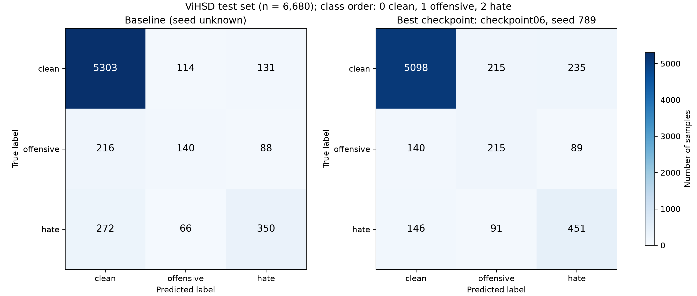
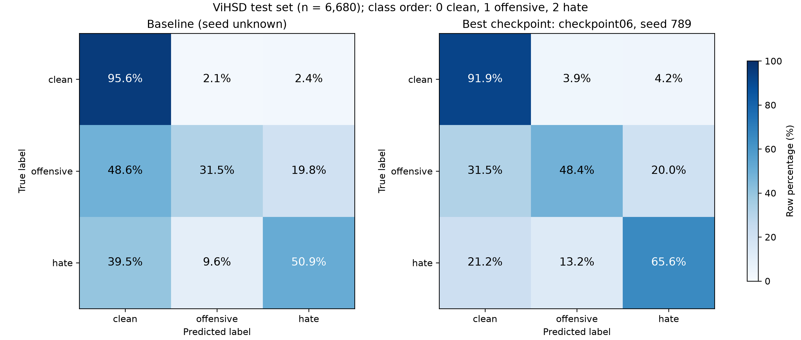

# PhoBERT–ViHSD

Dự án fine-tune và đánh giá PhoBERT cho phân loại bình luận mạng xã hội tiếng Việt thành ba lớp: `0` clean, `1` offensive, `2` hate. Macro-F1 là chỉ số chính vì dữ liệu mất cân bằng. Notebook mặc định dùng seed `42`; kết quả đã lưu gồm bốn seed `42`, `456`, `789`, `1049`.

Bộ dữ liệu ViHSD và mã baseline được kế thừa từ [sonlam1102/vihsd](https://github.com/sonlam1102/vihsd), công trình của **Son T. Luu, Kiet Van Nguyen và Ngan Luu-Thuy Nguyen (2021)**. Thông tin ghi công, trích dẫn và điều kiện sử dụng nằm ở [phần cuối README](#nguồn-gốc-tác-quyền-và-trích-dẫn).

## Những cải tiến đã triển khai

Đối chiếu với [notebook baseline](references/ViHSD_monolingual_Transformers.ipynb), các checkpoint triển khai những thay đổi sau:

| Thành phần | Baseline | Cải tiến đã triển khai |
| --- | --- | --- |
| Chuẩn hóa văn bản | Lọc stopwords và loại bỏ emoji | CP03/05/06 chuẩn hóa teencode, ánh xạ emoji thành văn bản, thu gọn ký tự lặp và tách từ bằng PyVi; giữ đại từ nhân xưng và từ phủ định. |
| Mất cân bằng lớp | Cross-Entropy thông thường | CP01 dùng trọng số lớp làm mịn theo căn bậc hai nghịch đảo tần suất; CP02 dùng Focal Loss (`gamma=1.5`); CP05/06 kết hợp thành Weighted Focal Loss. |
| Ngữ cảnh đầu vào | Tối đa 100 token | CP04/05/06 tăng lên 256 token để giảm việc cắt ngắn bình luận. |
| Tối ưu hóa | Huấn luyện 2 epoch | CP04/05 dùng learning rate riêng cho backbone/head (`2e-5`/`1e-4`), cosine scheduler với warmup 10%, tối đa 8 epoch, tích lũy gradient và early stopping theo Macro-F1 trên dev. |
| Tính toàn vẹn dữ liệu | Tiền xử lý trong notebook gốc | CP03/05/06 loại bản ghi train trùng dev/test, xử lý nội dung trùng có nhãn mâu thuẫn và kiểm tra dữ liệu trước/sau pipeline. |
| Backbone | `vinai/phobert-base` | CP06 thử nghiệm `vinai/phobert-base-v2`, đồng thời điều chỉnh learning rate backbone/head về `1.5e-5`/`5e-5`. |
| Khả năng tái lập | Đánh giá trong notebook | Lưu dự đoán, ma trận nhầm lẫn, chỉ số từng lớp và model/tokenizer; tổng hợp kết quả bốn seed. |

CP06 thay đổi cả backbone và learning rate, nên kết quả hiện có chưa tách riêng đóng góp của từng yếu tố. Cấu hình và mục tiêu đối chứng được trình bày trong [roadmap](docs/roadmap.md).

## Kết quả đã đạt được

Các giá trị dưới đây dùng thang `0–1`. Với CP01–06, Macro-F1 được báo cáo dưới dạng **trung bình ± độ lệch chuẩn** trên bốn seed; các cột còn lại là trung bình. Nguồn: [bảng tổng hợp bốn seed](outputs/evaluation_scores_mean_4seeds.csv). Baseline là một kết quả riêng, tính lại từ [ma trận trích xuất từ ảnh](outputs/baseline/confusion_matrix.csv), không phải trung bình bốn seed.

| Mô hình | Macro-F1 | Accuracy | F1 offensive | F1 hate |
| --- | ---: | ---: | ---: | ---: |
| Baseline từ ảnh | 0.6196 | 0.8672 | 0.3665 | 0.5569 |
| CP01: trọng số lớp | 0.6435 ± 0.0121 | 0.8582 | 0.4038 | 0.5965 |
| CP02: Focal Loss | 0.6387 ± 0.0115 | 0.8734 | 0.3923 | 0.5860 |
| CP03: tiền xử lý | 0.6450 ± 0.0138 | 0.8748 | 0.3955 | 0.6008 |
| CP04: chiến lược huấn luyện | 0.6444 ± 0.0083 | 0.8684 | 0.3995 | 0.5974 |
| CP05: tích hợp trên PhoBERT-base | 0.6522 ± 0.0134 | 0.8616 | 0.4276 | 0.5968 |
| **CP06: PhoBERT-base-v2** | **0.6587 ± 0.0067** | 0.8598 | **0.4310** | **0.6149** |

**CP06 có Macro-F1 trung bình cao nhất**, cao hơn baseline trong ảnh **3.91 điểm phần trăm**. Kết quả cho thấy cải thiện F1 ở hai lớp thiểu số, đồng thời Accuracy trung bình giảm từ `0.8672` xuống `0.8598`. Đây là so sánh mô tả; chưa có kết quả baseline trên bốn seed để kiểm định ý nghĩa thống kê.

Lần chạy có Macro-F1 cao nhất trong các kết quả đã lưu cũng thuộc **CP06, seed 789: `0.6649`**. CP05 đạt `0.6626` tại seed 456 và đứng đầu khi chỉ xét seed 456, như trong slide cũ; kết luận đó không đại diện cho toàn bộ bốn seed.

## So sánh ma trận nhầm lẫn

Baseline được trích số đếm từ [ảnh gốc](outputs/baseline/confusion_matrix.png). Ma trận đối chiếu lấy từ [CP06, seed 789](outputs/seed_789/checkpoint06/confusion_matrix.csv), là lần chạy tốt nhất của checkpoint có Macro-F1 trung bình cao nhất. Hai ma trận đều có **6,680 mẫu**, gồm `5,548 clean`, `444 offensive`, `688 hate`; hàng là nhãn thực tế, cột là nhãn dự đoán, theo thứ tự `clean`, `offensive`, `hate`.



Biểu đồ chuẩn hóa theo từng hàng giúp so sánh khả năng nhận diện từng lớp khi số lượng mẫu chênh lệch lớn:



| Chỉ số của hai ma trận | Baseline | CP06, seed 789 | Thay đổi |
| --- | ---: | ---: | ---: |
| Macro-F1 | 0.6196 | 0.6649 | +4.54 điểm phần trăm |
| Recall offensive | 31.53% | 48.42% | +16.89 điểm phần trăm |
| Recall hate | 50.87% | 65.55% | +14.68 điểm phần trăm |
| Offensive bị dự đoán thành clean | 216 | 140 | Giảm 76 mẫu |
| Hate bị dự đoán thành clean | 272 | 146 | Giảm 126 mẫu |
| Clean bị dự đoán thành offensive/hate | 245 | 450 | Tăng 205 mẫu |
| Accuracy | 86.72% | 86.29% | −0.43 điểm phần trăm |

Các số đếm cho thấy mô hình phát hiện thêm bình luận offensive/hate, đồng thời tăng số bình luận clean bị gán nhầm. Baseline chưa có seed hoặc dự đoán từng mẫu đi kèm; cùng số lượng và phân bố nhãn chưa đủ để xác minh từng bản ghi giữa hai lần chạy.

Tải ma trận dạng CSV: [baseline](outputs/comparison/baseline_confusion_matrix.csv), [checkpoint tốt nhất](outputs/comparison/best_confusion_matrix.csv). Xem thêm [đối chiếu chỉ số](outputs/comparison/evaluation_comparison.csv), [xếp hạng checkpoint](outputs/comparison/checkpoint_ranking.csv) và [nguồn dữ liệu, cách chọn checkpoint](outputs/comparison/provenance.json).

Tái tạo biểu đồ và bảng so sánh từ artifacts đã lưu:

```bash
uv run --no-sync python scripts/compare_confusion_matrices.py
```

## Môi trường

Cần Python `>=3.10` và `uv`. Java `>=8` được yêu cầu cho các checkpoint dùng VnCoreNLP (CP01, CP02, CP04); các checkpoint còn lại dùng PyVi.

```bash
uv venv
uv pip install -r requirements.txt
uv pip install -e .
uv run --no-sync jupyter notebook
```

Trong Jupyter, chọn kernel từ `.venv` của dự án. Mở notebook checkpoint cần chạy và thực thi tuần tự từ trên xuống dưới. Trên Colab/Kaggle, cài `uv` vào runtime notebook rồi bật `install_dependencies=True` ở cell thứ hai; trên máy cục bộ, cài dependencies trước và giữ tùy chọn này tắt. GPU phù hợp cho fine-tune đầy đủ, còn CPU chỉ nên dùng để kiểm tra nhanh.

## Cấu trúc

- `src/vihsd/`: các module NLP và đánh giá; `scripts/`: tiện ích dữ liệu.
- `notebooks/`: notebook fine-tuning CP01–06; `data/`: các split và tài nguyên chuẩn hóa.
- `outputs/`: kết quả; `checkpoints/`: model và tokenizer sinh ra khi huấn luyện.
- `references/` và `docs/`: tài liệu tham khảo và mô tả thí nghiệm. Weights và checkpoint sinh ra không được quản lý trong Git.

## Dữ liệu và đường dẫn

Mỗi split cần có các cột `free_text` và `label_id`; notebook cần đủ `train.csv`, `dev.csv`, `test.csv`. Cell đầu khai báo `project_root=None`, `data_root=None`, `mount_drive=False`. Notebook dò thư mục dự án từ thư mục làm việc hiện tại và các thư mục cha, dùng `/kaggle/working` làm dự phòng trên Kaggle; Google Drive chỉ được mount ở Colab khi bật tùy chọn. Dữ liệu được tìm trong `data/` rồi các đường dẫn Kaggle đã cấu hình. Nếu dùng thư mục split khác, đặt `data_root` thành thư mục chứa ba file. Thư mục `data/` cũng chứa tài nguyên chuẩn hóa.

`scripts/preprocess_data.py` là tiện ích tiền xử lý và xuất file có hậu tố `_processed.csv`; notebook fine-tuning không tự nạp các file này. Luồng huấn luyện chính hiện là notebook, không có lệnh CLI train.

## Checkpoint

| Checkpoint | Thí nghiệm | Notebook |
| --- | --- | --- |
| CP01 | Baseline với trọng số lớp tĩnh | [checkpoint01_baseline_class_weights.ipynb](notebooks/checkpoint01_baseline_class_weights.ipynb) |
| CP02 | Baseline với Focal Loss | [checkpoint02_baseline_focal_loss.ipynb](notebooks/checkpoint02_baseline_focal_loss.ipynb) |
| CP03 | Tiền xử lý văn bản với PyVi | [checkpoint03_data_preprocessing.ipynb](notebooks/checkpoint03_data_preprocessing.ipynb) |
| CP04 | Chiến lược huấn luyện nâng cao | [checkpoint04_training_strategies.ipynb](notebooks/checkpoint04_training_strategies.ipynb) |
| CP05 | Tích hợp các cải tiến CP01–04 | [checkpoint05_combined_enhancements.ipynb](notebooks/checkpoint05_combined_enhancements.ipynb) |
| CP06 | Backbone PhoBERT-base-v2 | [checkpoint06_phobert_base_v2.ipynb](notebooks/checkpoint06_phobert_base_v2.ipynb) |

Chi tiết cấu hình và mục tiêu từng thí nghiệm nằm trong [docs/roadmap.md](docs/roadmap.md).

## Đầu ra

Mỗi notebook lưu model và tokenizer tại `checkpoints/<checkpoint>/final_model/`, cùng kết quả tại `outputs/<checkpoint>/`. Bộ kết quả gồm `evaluation_scores.csv`, `predictions.csv`, `classification_report.csv`, `confusion_matrix.csv` và `confusion_matrix_<checkpoint>.png`. Nhãn trong báo cáo và ma trận giữ thứ tự clean, offensive, hate.

## Nguồn gốc, tác quyền và trích dẫn

### Ghi công công trình gốc

- **Bộ dữ liệu ViHSD:** do Son T. Luu, Kiet Van Nguyen và Ngan Luu-Thuy Nguyen giới thiệu trong bài báo [A Large-Scale Dataset for Hate Speech Detection on Vietnamese Social Media Texts](https://doi.org/10.1007/978-3-030-79457-6_35), IEA/AIE 2021, trang 415–426. [Bản arXiv](https://arxiv.org/abs/2103.11528).
- **Mã nguồn baseline:** từ [repository ViHSD của tác giả](https://github.com/sonlam1102/vihsd), trong đó có [ViHSD_monolingual_Transformers.ipynb](https://github.com/sonlam1102/vihsd/blob/main/ViHSD_monolingual_Transformers.ipynb). Bản tham chiếu trong dự án nằm ở `references/ViHSD_monolingual_Transformers.ipynb`.
- **Nguồn truy cập dữ liệu:** [uitnlp/vihsd trên Hugging Face](https://huggingface.co/datasets/uitnlp/vihsd), được README gốc dẫn liên kết. Liên hệ về dữ liệu: **Son Thanh Luu**, `sonlt@uit.edu.vn`.

Đóng góp của repository này là các cải tiến fine-tune, tiền xử lý và đánh giá được mô tả ở trên. Quyền tác giả đối với bộ dữ liệu, bài báo và phần mã baseline kế thừa thuộc các tác giả/chủ sở hữu tương ứng; dự án này ghi nhận và giữ nguồn của các thành phần đó.

### Điều kiện sử dụng từ nguồn

[README gốc](https://github.com/sonlam1102/vihsd/blob/main/README.md) nêu dữ liệu **chỉ dùng cho mục đích nghiên cứu** và yêu cầu trích dẫn bài báo khi sử dụng. Tại thời điểm đối chiếu ngày **24/11/2026**, repository GitHub chưa có tệp `LICENSE` riêng; [trang Hugging Face](https://huggingface.co/datasets/uitnlp/vihsd) hiển thị metadata giấy phép `mit` và yêu cầu chấp thuận điều kiện truy cập dữ liệu.

Dự án này sử dụng ViHSD trong phạm vi nghiên cứu theo hướng dẫn của README gốc. Khi sử dụng hoặc phân phối lại dữ liệu/mã kế thừa, cần đối chiếu điều kiện tại nguồn và liên hệ tác giả để làm rõ phạm vi được phép khi cần. Phần ghi công này không cấp lại giấy phép cho các thành phần gốc.

### Trích dẫn ViHSD

Khi sử dụng ViHSD trong báo cáo, luận văn hoặc công bố, trích dẫn bài báo theo thông tin do tác giả cung cấp:

```bibtex
@inproceedings{luu2021vihsd,
  author    = {Luu, Son T. and Nguyen, Kiet Van and Nguyen, Ngan Luu-Thuy},
  title     = {A Large-Scale Dataset for Hate Speech Detection on Vietnamese Social Media Texts},
  booktitle = {Advances and Trends in Artificial Intelligence. Artificial Intelligence Practices},
  year      = {2021},
  publisher = {Springer International Publishing},
  pages     = {415--426},
  doi       = {10.1007/978-3-030-79457-6_35}
}
```
